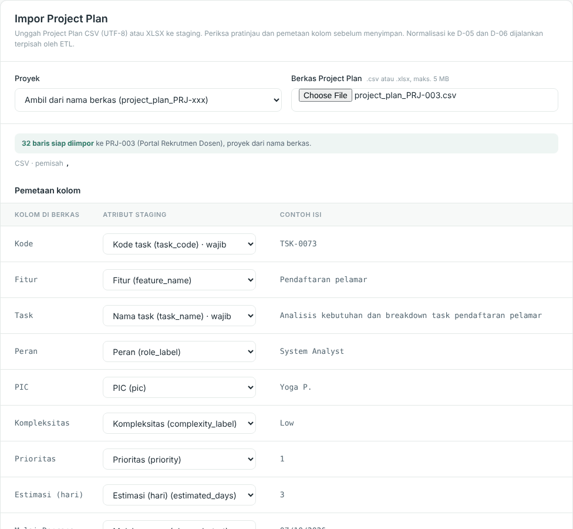
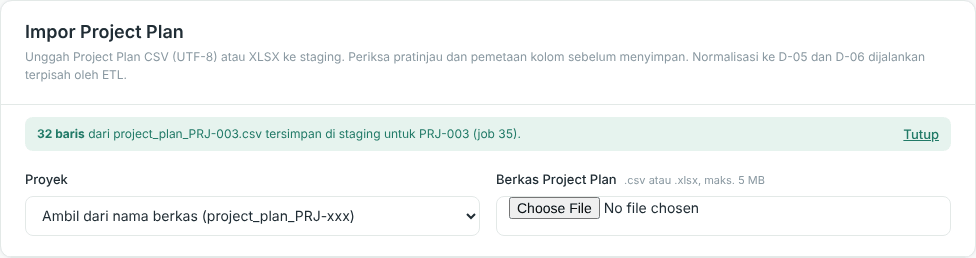
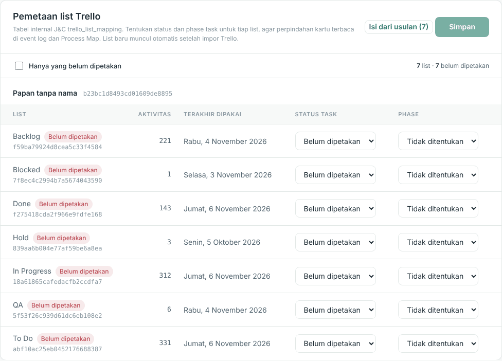
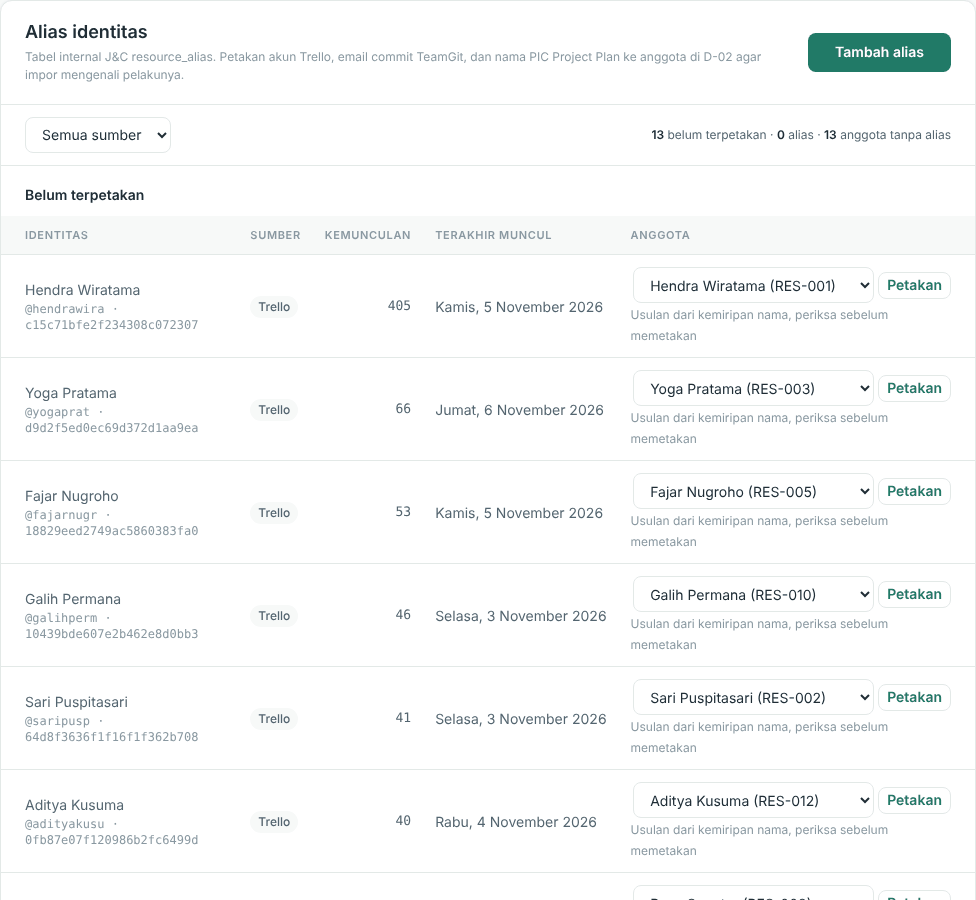
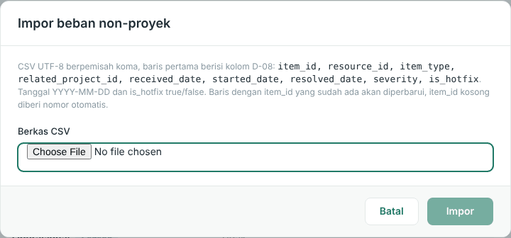

# Panduan impor data (DIG-219)

Panduan ini menjelaskan cara memasukkan data sumber PuTI ke aplikasi Digital Twin.

- **Bagian A** untuk **Administrator Data** yang mengimpor data lewat halaman **Data**.
- **Bagian B** untuk **admin** yang mengelola server: akun, kredensial, jadwal impor, dan pemantauan.

Rincian teknis pipeline ada di [IMPORT_PIPELINE.md](IMPORT_PIPELINE.md), konektor Trello di
[TRELLO_API.md](TRELLO_API.md), dan aturan kualitas data di
[DATA_QUALITY_RULES.md](DATA_QUALITY_RULES.md).

## Gambaran alur

| Sumber | Cara masuk | Tujuan | Menu |
| --- | --- | --- | --- |
| Project Plan (CSV/XLSX) | Unggah manual | `staging_project_plan` | Data > Impor dataset |
| Riwayat kartu Trello | Job impor lewat Trello API, terjadwal atau manual dari server | `staging_trello_action` | Dijalankan admin (Bagian B) |
| Pemetaan list Trello | Diisi manual setelah impor Trello | `trello_list_mapping` | Data > Pemetaan Trello |
| Alias identitas | Diisi manual | `resource_alias` | Data > Alias identitas |
| Beban non-proyek (D-08) | Unggah CSV | `workload_items` | Data > Beban non-proyek > Impor CSV |

Data Project Plan dan Trello masuk ke **staging** apa adanya. Normalisasi dan pemuatan ke
final sources D-05 sampai D-08 dikerjakan ETL (DIG-29), lalu validasi kualitas data (DIG-31)
menandai baris yang bermasalah.

---

## Bagian A. Panduan pengguna (Administrator Data)

### A.1 Peran yang dibutuhkan

| Pekerjaan | Izin | Peran |
| --- | --- | --- |
| Unggah Project Plan, pemetaan list Trello | `import:run` | Administrator Data |
| Alias identitas | `master_data:write` | Administrator Data |
| Impor CSV beban non-proyek | `import:run` untuk tombol **Impor CSV**, ditambah `workload:read_all` untuk membuka tab **Beban non-proyek** | Administrator Data **dan** System Analyst (atau Kaur/Asman) |
| Melihat riwayat job impor | `data_quality:read` | Administrator Data, System Analyst |

Tab yang tidak sesuai peran akun tidak ditampilkan. Bila tab yang dibutuhkan tidak muncul,
minta admin menambahkan perannya (Bagian B.1).

### A.2 Urutan kerja yang disarankan

1. Pastikan master data sudah lengkap: proyek (D-01) dan anggota (D-02).
2. Minta admin menjalankan impor Trello (Bagian B.3), lalu petakan list Trello (A.4).
3. Unggah Project Plan setiap proyek (A.3).
4. Petakan alias identitas yang belum dikenali (A.5).
5. Impor beban non-proyek bila ada (A.6).

Alias dan pemetaan list cukup diisi sekali. Setelah impor berikutnya, cek lagi apakah ada
list atau identitas baru yang belum dipetakan.

### A.3 Unggah Project Plan

Menu **Data > Impor dataset**.



1. **Proyek.** Pilih proyek dari daftar, atau biarkan **Ambil dari nama berkas** bila nama
   berkasnya berpola `project_plan_PRJ-xxx.csv` atau `.xlsx`.
2. **Berkas.** Pilih berkas `.csv` (UTF-8, pemisah `,` atau `;`) atau `.xlsx`, paling besar
   5 MB dan 10.000 baris data. Pratinjau langsung dibuat tanpa menyimpan apa pun.
3. **Sheet.** Untuk XLSX dengan beberapa sheet, pilih sheet yang berisi rencana. Pemetaan kolom
   dimulai ulang setiap ganti sheet.
4. **Periksa ringkasan.** Kotak hijau menyebut jumlah baris yang siap diimpor. Kotak merah
   berarti struktur berkas bermasalah, dan tombol impor dikunci sampai masalahnya beres.
5. **Periksa pemetaan kolom.** Judul kolom templat (Kode, Fitur, Task, Peran, PIC, Kompleksitas,
   Prioritas, Estimasi (hari), Mulai/Selesai Rencana, Mulai/Selesai Aktual, Status,
   Bergantung Pada, Catatan) dikenali otomatis. Bila judul kolom di berkas berbeda, pilih atribut
   yang benar di kolom **Atribut staging**. Pilih **Tidak dipetakan** untuk kolom yang tidak
   dipakai; isinya tetap disimpan di kolom `raw`. Kode task dan nama task **wajib** terpetakan.
   Klik **Kembalikan pemetaan otomatis** untuk membatalkan semua perubahan.
6. **Periksa pratinjau.** Tabel menampilkan 20 baris pertama sesuai pemetaan.
7. Klik **Impor N baris ke staging**.



Hal yang perlu diketahui:

- Nilai sel disimpan **apa adanya**. Format tanggal, nama PIC, status, dan dependency belum
  diperiksa di tahap ini, melainkan saat validasi dan ETL.
- Bila berkas yang sama persis sudah pernah diimpor untuk proyek itu, muncul peringatan kuning.
  Mengimpor lagi tetap boleh dan menghasilkan batch baru; ETL memakai batch sukses terakhir per
  proyek.
- Setiap impor tercatat sebagai job `project_plan` di riwayat job impor, termasuk yang gagal.

### A.4 Pemetaan list Trello

Menu **Data > Pemetaan Trello**. List papan Trello muncul otomatis setelah impor Trello pertama.



1. Centang **Hanya yang belum dipetakan** untuk fokus ke list baru.
2. Klik **Isi dari usulan** untuk mengisi status dan phase dari nama list (misalnya "In Progress"
   menjadi `in_progress`, "QA" menjadi `in_qa`). Usulan hanya isian awal dan **tidak tersimpan**
   sebelum diperiksa.
3. Sesuaikan **Status task** dan **Phase** tiap list. Phase boleh **Tidak ditentukan** bila list
   tidak mewakili fase tertentu.
4. Klik **Simpan**.

Pemetaan ini menentukan cara perpindahan kartu antar list terbaca di event log dan Process Map.
Impor Trello berikutnya tidak pernah mengubah pemetaan yang sudah disimpan.

### A.5 Alias identitas

Menu **Data > Alias identitas**. Satu anggota bisa punya nama berbeda di tiap sumber, misalnya
akun Trello `@hendrawira`, email commit, dan nama PIC "Hendra W." di Project Plan. Alias
menghubungkan semuanya ke satu anggota di D-02.



1. Bagian **Belum terpetakan** berisi identitas dari data staging yang belum dikenali, diurutkan
   dari yang paling sering muncul. Saring per sumber dengan pilihan **Semua sumber**.
2. Kolom **Anggota** sudah berisi usulan dari kemiripan nama. **Periksa dulu**, ganti bila salah,
   lalu klik **Petakan**.
3. Untuk identitas yang belum muncul di staging, klik **Tambah alias** dan isi sesuai sumbernya:
   - Trello: id member Trello (24 karakter heksadesimal);
   - TeamGit: email author commit;
   - Project Plan: nama PIC persis seperti di berkas.
4. Alias yang salah bisa dipindahkan ke anggota lain (**Pindahkan**) atau dihapus (**Hapus**) di bagian **Sudah terpetakan**.

Satu anggota boleh punya beberapa alias.

### A.6 Impor beban non-proyek (D-08)

Menu **Data > Beban non-proyek**, tombol **Impor CSV**.



1. Siapkan CSV UTF-8 berpemisah koma dengan baris judul:
   `item_id, resource_id, item_type, related_project_id, received_date, started_date,
   resolved_date, severity, is_hotfix`.
   Tanggal berformat `YYYY-MM-DD`, `is_hotfix` berisi `true` atau `false`.
2. Pilih berkas. Aplikasi memeriksa semua baris lebih dulu.
3. Bila ada kesalahan, tabel menampilkan nomor baris, kolom, dan pesannya, dan **tidak ada data
   yang disimpan**. Perbaiki berkas lalu pilih ulang.
4. Bila semua baris benar, klik **Impor**. Baris dengan `item_id` yang sudah ada akan diperbarui,
   dan `item_id` kosong diberi nomor otomatis, jadi impor ulang tidak menggandakan data.

### A.7 Pesan yang sering muncul

| Pesan | Penyebab | Yang dilakukan |
| --- | --- | --- |
| Berkas harus .csv atau .xlsx | Format lain, misalnya `.xls` | Simpan ulang sebagai `.xlsx` atau CSV UTF-8 |
| Berkas lebih dari 5 MB | Berkas terlalu besar | Pecah per proyek atau hapus sheet yang tidak dipakai |
| Pilih proyek, atau beri nama berkas berpola project_plan_PRJ-xxx | Proyek tidak dipilih dan nama berkas tidak memuat kode proyek | Pilih proyek di daftar |
| Kolom wajib tidak ditemukan: task_code | Kolom kode task tidak terpetakan | Petakan kolom kode task, atau klik Kembalikan pemetaan otomatis |
| Atribut … dipetakan dari dua kolom | Dua kolom berkas diarahkan ke atribut yang sama | Ubah salah satunya menjadi Tidak dipetakan |
| Nama kolom ganda | Dua judul kolom sama di berkas | Ganti salah satu judul kolom di berkas |
| Impor Project Plan lain sedang berjalan | Ada unggahan lain yang belum selesai | Tunggu sebentar lalu klik impor lagi |
| Kegagalan tercatat di riwayat job impor | Impor gagal setelah pratinjau | Ulangi pratinjau; bila tetap gagal, kirim nomor job ke admin |
| API belum terhubung | Server API mati atau jaringan terputus | Hubungi admin |

---

## Bagian B. Panduan admin

Perintah di bawah dijalankan dari folder `backend` dengan virtualenv aktif. Di staging dan
produksi yang memakai Docker Compose, awali dengan
`docker compose -f compose.prod.yaml --env-file staging.env exec api`, misalnya:

```bash
docker compose -f compose.prod.yaml --env-file staging.env exec api python -m app.pipeline.run trello
```

### B.1 Akun dan peran

```bash
python -m app.modules.auth.create_user --username davi --full-name "Davi Ardian"
python -m app.modules.auth.set_roles --list
python -m app.modules.auth.set_roles --username davi --role admin_data --role system_analyst
```

Di Docker, `create_user` butuh `exec -it` karena password diminta lewat prompt. `set_roles`
mengganti seluruh peran akun, jadi sebutkan semua peran yang ingin dipertahankan. Peran yang
dibutuhkan tiap pekerjaan ada di A.1.

### B.2 Kredensial Trello

1. Buat API key dan token dengan scope **read** di <https://trello.com/app-key>.
2. Isi pengaturan berikut. Di lokal lewat `backend/.env`. Di server, simpan key dan token
   sebagai berkas rahasia di `SECRETS_DIR`, satu berkas per rahasia (lihat
   [SECRETS.md](SECRETS.md)).

   | Variabel | Contoh | Rahasia |
   | --- | --- | --- |
   | `TRELLO_API_ENABLED` | `true` | Tidak |
   | `TRELLO_BOARD_IDS` | `AbCd1234,EfGh5678` (shortLink dari URL papan, dipisah koma) | Tidak |
   | `TRELLO_API_KEY` | | Ya |
   | `TRELLO_API_TOKEN` | | Ya |
   | `NOTIFY_WEBHOOK_URL` | Incoming webhook Slack, Discord, Google Chat, atau Mattermost | Ya |

3. Uji koneksi dari server yang akan menjalankan impor:

   ```bash
   python -m app.integrations.connectivity
   ```

   Kode keluar `0` berarti DNS, TCP, HTTPS, dan kredensial lolos. Hasil tidak pernah memuat key
   atau token.

### B.3 Menjalankan dan menjadwalkan impor Trello

Jalan manual:

```bash
python -m app.pipeline.run trello
```

| Kode keluar | Arti |
| --- | --- |
| `0` | Berhasil |
| `1` | Gagal setelah semua percobaan; lihat `import_job.error` dan log |
| `2` | Job Trello lain masih berjalan, job baru tidak dimulai |

Impor aman diulang: action yang sudah ada tidak ditulis dua kali. Setelah impor pertama, minta
Administrator Data memetakan list Trello (A.4) dan alias (A.5).

Untuk jadwal berkala, pakai cron atau systemd timer dengan `--trigger schedule`. Contoh lengkap
ada di [IMPORT_PIPELINE.md](IMPORT_PIPELINE.md#menjadwalkan-di-server-staging-dig-49).
Pengaturan retry: `IMPORT_MAX_ATTEMPTS` (bawaan 3), `IMPORT_RETRY_DELAY_SECONDS` (bawaan 60),
dan `IMPORT_STALE_MINUTES` (bawaan 120).

### B.4 Memantau job impor

- API: `GET /api/v1/data/import-jobs?source=trello&status=failed&limit=20` dan
  `GET /api/v1/data/import-jobs/{job_id}` (izin `data_quality:read`). Sumber yang tersedia:
  `trello` dan `project_plan`.
- Basis data:

  ```sql
  SELECT job_id, source, status, attempts, started_at, finished_at, rows_written, error
  FROM import_job
  ORDER BY started_at DESC
  LIMIT 20;
  ```

- Job yang ditandai `stale: true` masih `running` tetapi melewati `IMPORT_STALE_MINUTES`. Proses
  kemungkinan mati, misalnya karena server restart. Job ini ditutup `failed` otomatis saat job
  sumber yang sama berikutnya dimulai.
- Bila `NOTIFY_WEBHOOK_URL` terisi, job terjadwal yang gagal mengirim notifikasi ke kanal tim.
  Unggahan Project Plan tidak mengirim notifikasi karena pengunggah langsung melihat hasilnya.

| Gejala | Kemungkinan penyebab | Tindakan |
| --- | --- | --- |
| Job Trello gagal dengan kredensial ditolak | Token kedaluwarsa atau tidak punya akses ke papan | Buat token baru, cek akun pemilik token adalah anggota papan |
| Papan tidak ditemukan | shortLink salah di `TRELLO_BOARD_IDS` | Salin 8 karakter setelah `trello.com/b/` |
| Kode keluar `2` terus-menerus | Job lama macet berstatus `running` | Tunggu melewati `IMPORT_STALE_MINUTES`, lalu jalankan ulang |
| Unggahan Project Plan gagal dengan nomor job | Struktur berkas rusak | Lihat `error` job tersebut, minta pengunggah memperbaiki berkas |

### B.5 Memeriksa kualitas data (sementara lewat CLI)

Sampai laporan kualitas data tersedia di aplikasi (DIG-146, DIG-147), validator dijalankan dari
terminal. Validator hanya membaca dan tidak mengubah data.

```bash
python -m app.modules.data.quality.run --database --trello --currentness --as-of 2026-11-22 --out hasil-kualitas
```

Folder `--out` berisi `ringkasan.csv`, `temuan.csv`, `baris_ditolak.csv`, `kelengkapan.csv`, dan
`currentness.csv`. Arti setiap `rule_id` ada di [DATA_QUALITY_RULES.md](DATA_QUALITY_RULES.md).

## Batasan saat ini

- **Ekspor JSON Trello** belum bisa diunggah dari aplikasi; impor Trello hanya lewat Trello API
  (B.3).
- **Impor riwayat commit TeamGit** belum tersedia (DIG-27). Alias sumber TeamGit sudah bisa diisi
  lebih dulu.
- **ETL ke final sources** (DIG-29) dan **laporan kualitas data di aplikasi** (DIG-146, DIG-147)
  masih dikerjakan. Sampai keduanya selesai, data hasil impor baru tersimpan di staging.
